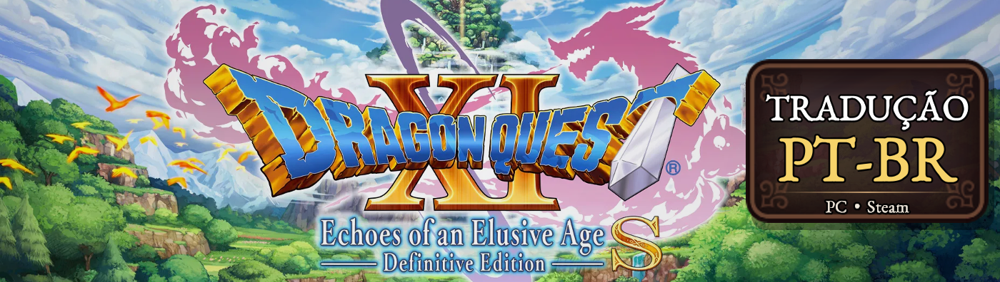
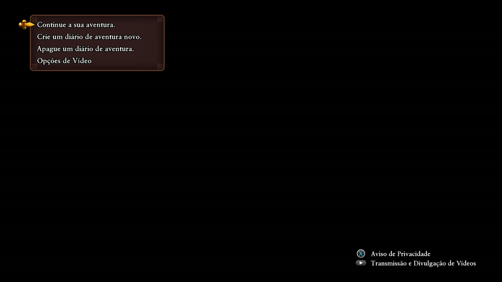
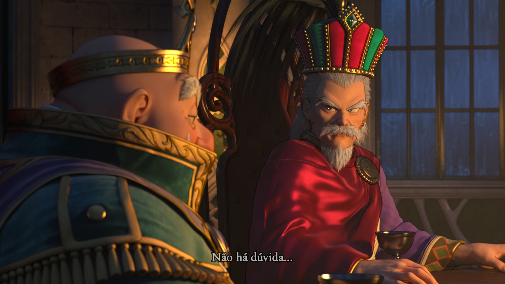
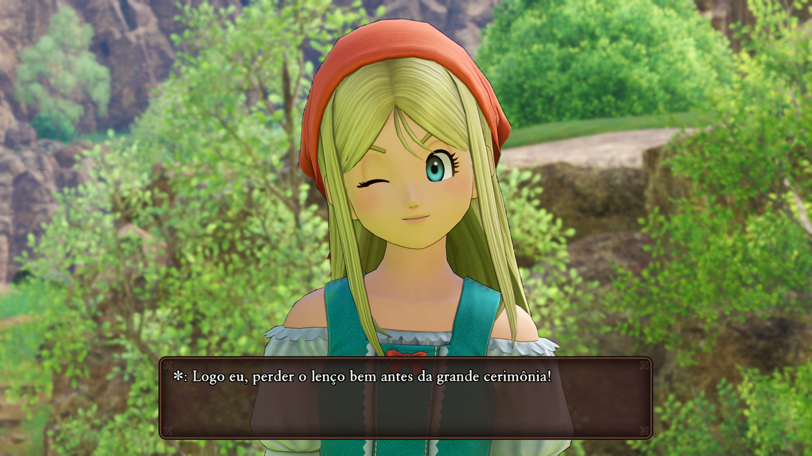
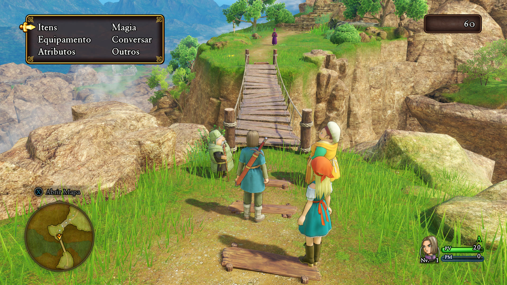
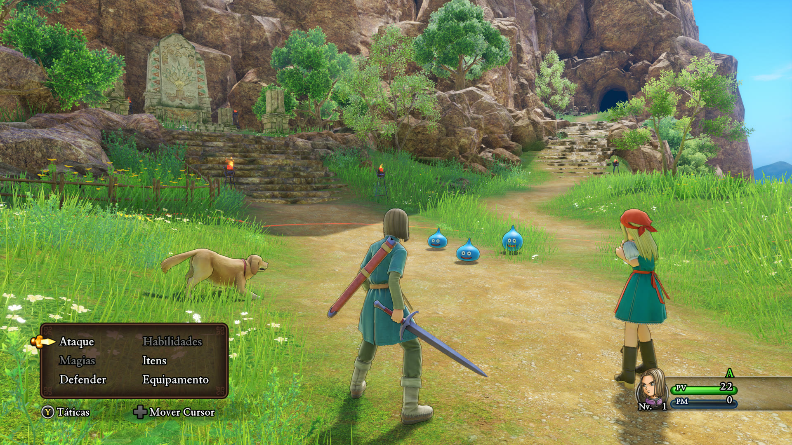
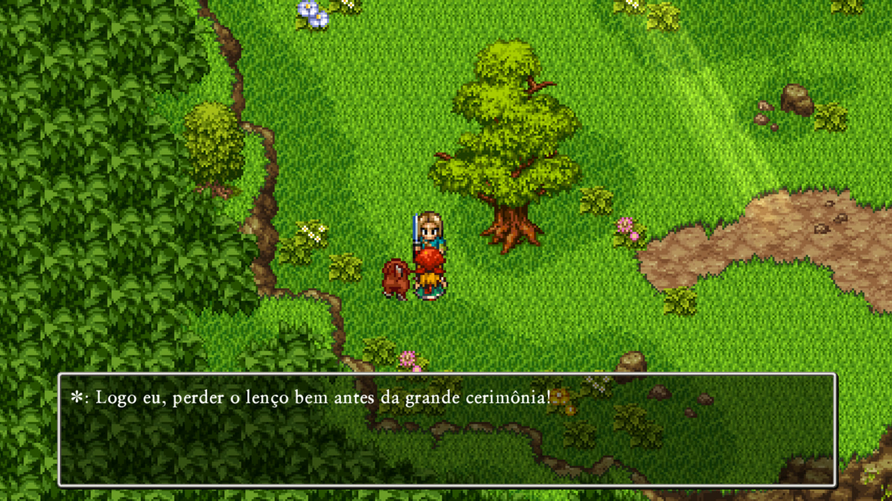
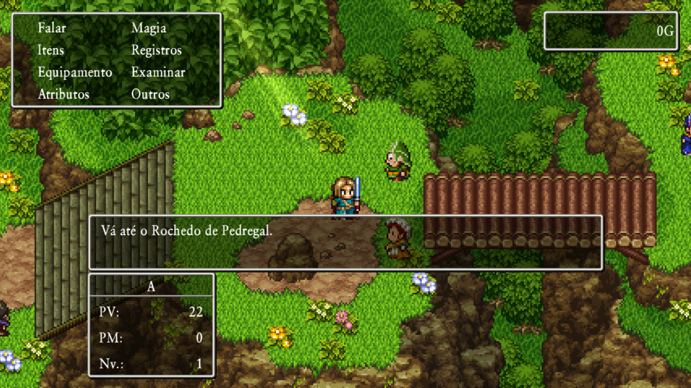
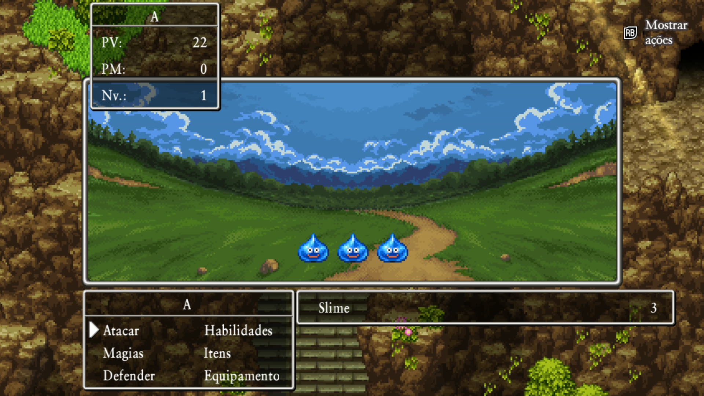

# 🐉 Dragon Quest XI S: Echoes of an Elusive Age — Definitive Edition (PC) — Tradução PT-BR

-009c3b)

Tradução de fã do **Dragon Quest XI S: Echoes of an Elusive Age — Definitive Edition** (PC, Steam).
**Tradução completa para o português do Brasil** do modo 3D e do modo 2D, com menus, história, diálogos, magias,
itens, monstros, lugares, missões, minijogos e descrições em português.

*Feita por fãs, para fãs. Gratuita, sem fins lucrativos e sem nenhuma ligação com a Square Enix (veja o aviso legal no
fim desta página).*

> ✅ O jogo inteiro está traduzido, nos dois modos. Se achar algum problema, abra uma [issue](../../issues).

## 📸 Fotos

| | |
|---|---|
|  |  |
| Menu inicial | Cena com legenda |
|  |  |
| Diálogo com a Gemma | Menu de campo |
|  |  |
| Batalha | Modo 2D: diálogo |
|  |  |
| Modo 2D: menu | Modo 2D: batalha |

## 📥 Download

**[⬇️ Baixar a tradução](../../releases/latest)** (página da versão mais recente). Dentro do zip vem o arquivo `.pak` da
tradução e um guia `LEIA-ME.txt`. Como instalar: veja **💾 Instalação** abaixo.

## 🎮 O que foi traduzido

| Parte | Textos | Cobertura |
|---|---|---|
| Modo 3D: diálogos, cenas, moradores, conversas do grupo, livros, missões, menus, batalha, lojas, minijogos | 75.349 | 100% |
| Modo 2D: diálogos, cenas, menus e batalha | 59.803 | 100% |
| Imagens com texto (avisos, carimbos, placares, minijogos, dicas da batalha do 2D) | 84 | traduzidas |

- **Tudo a partir do inglês**, conferido com o japonês, com o contexto da história e de quem está falando em cada fala.
  Quando o inglês faz piada, rima ou trocadilho, a piada foi recriada em português em vez de traduzida ao pé da letra.
- **Cada personagem fala do seu jeito:** o Rab com sotaque gaúcho leve (*"Bah, tchê!"*), o Sylvando exagerado e
  teatral, o Erik malandro, a Veronica com os apelidos que dá para todo mundo, o Quentô falando em haicai e as cidades com
  sotaque próprio (o italiano de Gondolia, o espanhol de Puerto Valor, as palavras nórdicas de Friolheim).
- **Fala antiga onde o jogo é antigo:** os personagens que falam arcaico no inglês usam "tu" e "vós" em português.
- **Interface:** PV/PM no lugar de HP/MP, artigos e gênero corretos nas mensagens de batalha e "O" de ouro no lugar do
  "G" das moedas.

### Alguns exemplos

- **Herói:** *Eleven → Onze*.
- **Lugares:** os nomes próprios ficam (Heliodor, Gondolia, Puerto Valor); os que são piada ou descrição foram recriados
  (*Cobblestone → Pedregal · Gallopolis → Galópolis · Sniflheim → Friolheim · Tickington → Vila Tique*).
- **Termos:** *Luminary → Luminar · Pep → Pique · Draconian Quest → Missão Draconiana*.
- **Monstros:** traduzidos com graça; Slime fica, porque já é palavra usada no Brasil e é o mascote da série, e os
  slimes falam "gosma" (*"Gosmaravilha!"*).

## 🚫 O que não foi traduzido (de propósito)

| O quê | Por quê |
|---|---|
| Nomes próprios (Erik, Veronica, Serena, Sylvando, Jade, Rab, Heliodor, Gondolia…) | São nomes, iguais em todas as versões do jogo. |
| Tela de título (logotipo e legendas do vídeo de abertura) | Arte e marca registrada; o nome do jogo fica igual no logo e no vídeo. |
| Caça-níqueis do cassino | As telas têm imagens que não dá para traduzir; para não misturar português e inglês na mesma tela, ficam inteiras no original. |
| Imagens dos tutoriais | São capturas da tela; o texto das dicas está traduzido. |
| Créditos finais (cargos e nomes da equipe) | Ficam como no original. |
| Nome do idioma no menu | A lista de idiomas é fixa no jogo: a tradução entra no lugar do inglês. |
| Vozes | Ficam as vozes originais. |

## 💿 O que você precisa

Você precisa da sua **própria cópia** do **Dragon Quest XI S: Echoes of an Elusive Age — Definitive Edition** para
**PC (Steam)**. **Este projeto não distribui o jogo.**

## 💾 Instalação

A tradução é um arquivo `.pak` que o jogo carrega **por cima** dos arquivos originais. Nenhum arquivo do jogo é
alterado.

1. Copie o arquivo `pakchunk0-WindowsNoEditor_1_P.pak` para a pasta `Paks` do jogo:
   `...\steamapps\common\DRAGON QUEST XI S\Game\Content\Paks\`
   (na Steam: botão direito no jogo → *Gerenciar* → *Explorar arquivos locais* → `Game\Content\Paks`).
2. Abra o jogo com o idioma do texto em **Inglês** (*English*).

- **Para atualizar**, troque o `.pak` antigo da tradução pelo novo. **Para voltar ao inglês**, só apague o `.pak`.
- **Outras traduções:** se houver outro `.pak` de tradução na pasta `Paks` (de outra equipe), tire-o antes; com dois,
  o jogo mistura os textos.
- **Modo 2D:** já vem traduzido no mesmo arquivo; para jogar nele, use a opção do próprio jogo (igreja ou Novo Jogo).

Saves do jogo em inglês funcionam normalmente.

## 🔒 Segurança

- Baixe a tradução **só pela página de [Releases](../../releases) deste repositório**.
- A tradução é só o arquivo `.pak` com os textos e as imagens: **não há executável** nem instalador.

## ❓ Não funcionou?

| Sintoma | Causa provável |
|---|---|
| Continua tudo em inglês | O `.pak` não está em `Game\Content\Paks`, ou o idioma do texto não está em *Inglês* (*English*). |
| Textos misturados ou nomes antigos | Há outro `.pak` de tradução na pasta `Paks` (de outra equipe ou de uma versão anterior desta). Deixe só o novo. |
| Algo em inglês depois de uma atualização do jogo | A atualização pode ter mudado os textos. Abra uma issue. |
| Travamento ou tela preta | Abra uma issue informando onde aconteceu. |

## 🐞 Achou um erro?

Abra uma [issue](../../issues/new/choose) usando o formulário "Erro na tradução". Informe a versão do patch, o modo
(3D ou 2D), o lugar e, se puder, mande um print. Toda correção de português também é bem-vinda.

## 🙏 Créditos

- **Tradução, revisão e ferramentas:** [0xdhx0](https://github.com/0xdhx0).
- **Fontes livres** usadas nas imagens: Corben e M PLUS Rounded 1c (licença OFL).

**Como foi feita:** a tradução usou ferramentas de IA. Todo o texto foi traduzido a partir do inglês com o contexto da
história e o jeito de falar de cada personagem, e testado no jogo. Se achar uma frase estranha, abra uma
[issue](../../issues), porque toda sugestão ajuda.

## ⚖️ Aviso legal e uso

- Esta é uma **tradução feita por fãs, para fãs**, **gratuita** e **sem fins lucrativos**.
- **Não temos nenhuma ligação** com a Square Enix ou qualquer outra empresa envolvida no jogo. O projeto não é oficial,
  nem aprovado ou apoiado por elas.
- *Dragon Quest XI S: Echoes of an Elusive Age — Definitive Edition* e todos os nomes, marcas e personagens pertencem
  aos seus donos (© ARMOR PROJECT/BIRD STUDIO/SQUARE ENIX, © SUGIYAMA KOBO).
- O pacote contém **só os arquivos da tradução** (um `.pak`) e **não funciona sem o jogo original**. O jogo não é
  distribuído aqui: não peça nem compartilhe cópias do jogo neste repositório.
- Pode usar e compartilhar a tradução à vontade, **de graça**. Ela **não pode ser vendida** nem monetizada. Se alguém
  cobrou por ela, você foi enganado. Veja [LICENSE.txt](LICENSE.txt).
- Se você é detentor de algum direito e quer que algo seja retirado, abra uma issue ou entre em contato pelo GitHub.

Apoie a franquia comprando os jogos oficiais.
